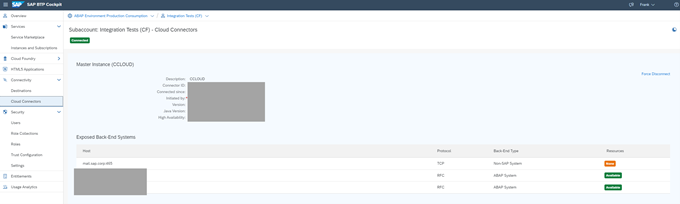
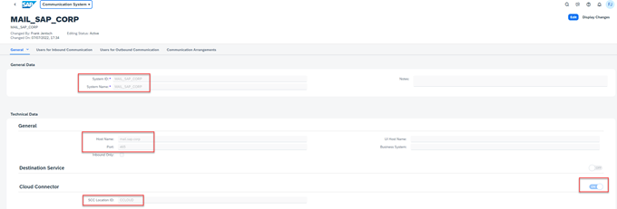
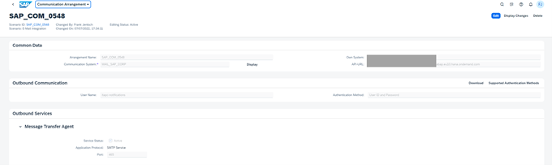

# send-mail-demo

This example shows you how to generate and send email using Steampunk ([SAP Business AI Platform, ABAP environment](https://community.sap.com/topics/btp-abap-environment)).

## Implementation

The abstract utility class `ZCL_MAIL_GEN` generates email by replacing predefined text placeholders. To send email, the example calls the released API described in the official [documentation](https://help.sap.com/docs/sap-btp-abap-environment/abap-environment/output-management-sending-mails-using-smtp).

The HTML email layout uses tables and inline CSS for compatibility with a wider range of email clients.

The concrete email template class `ZCL_MAIL_GEN_MATERIAL` inherits from `ZCL_MAIL_GEN` and generates email using two text placeholders: recipient and material.

You can run `ZCL_MAIL_GEN_TEST` with the ABAP Development Tools (ADT) class runner to generate an example email based on `ZCL_MAIL_GEN_MATERIAL`. The email contains a formatted version of the following text:

**Material Notification**

Dear Mr. Mayer,

Material **Screw 3x4** has been created.

Best regards

This example generates email using ABAP code. You can also maintain email templates in ADT as a dedicated transportable object type. See the [documentation](https://help.sap.com/docs/sap-btp-abap-environment/abap-environment/e-mail-templates) for instructions on using the ADT editor and referencing email templates in your ABAP code.

The repository also contains two other classes:

- `ZCL_MAIL_SIMPLE` provides a minimal, Hello World-style example of generating HTML email.
- `ZCL_MAIL_SETUP_SHOW` displays the current system outbound email settings. See the [documentation](https://help.sap.com/docs/sap-btp-abap-environment/abap-environment/configuration-of-system-mail-outbound) for the supported configuration options.

## Set up email connectivity with an existing SMTP server

### Prerequisites

- An SMTP server
- An SAP Cloud Connector (SCC) configured for that SMTP server
- The Cloud Connector assigned to the relevant SAP Business AI Platform subaccount

In the SAP BTP Cockpit, your Cloud Connector configuration should look like this:

### Set up the communication arrangement

Create a communication arrangement based on scenario `SAP_COM_0548`. Within the communication arrangement, create a communication system:

Configure the outbound communication user for SMTP access. The resulting communication arrangement should look like this:

Do not create a destination for email in the SAP BTP Cockpit. That approach is deprecated in Steampunk; use a communication arrangement instead.
